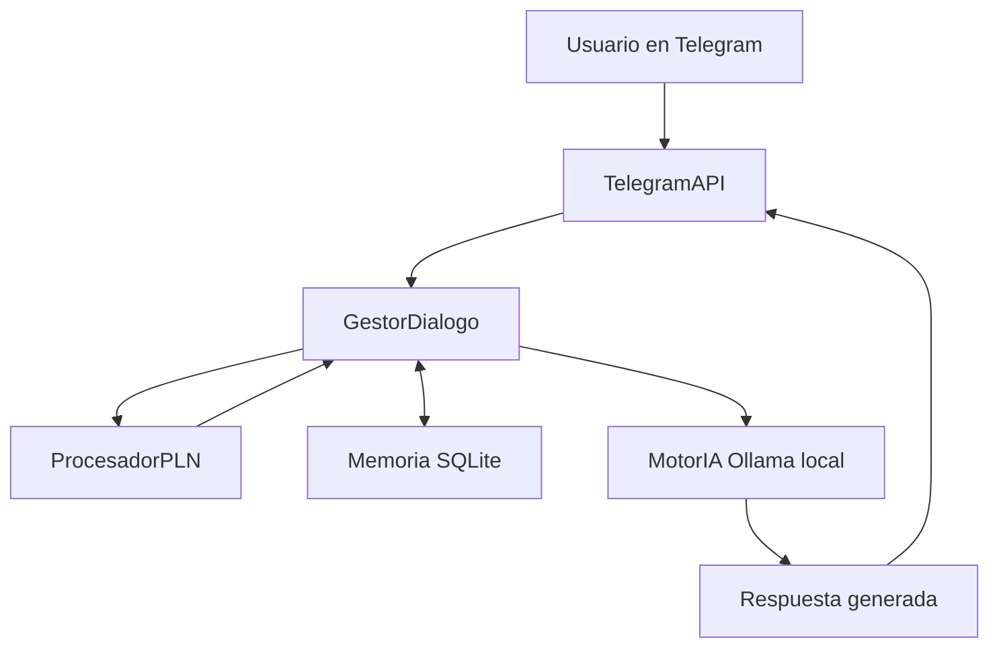

# Taskbot con Ollama local

Los comandos de control y el flujo explícito /ticket se procesan en GestorDialogo.
Todos los mensajes normales pasan al modelo, sin bloquear por intención técnica.
El motor recibe la pregunta, contexto reciente y entidades. No tiene búsqueda web.
Si hay un error de generación, muestra el aviso y no lo agrega al contexto.
Telegram es la única interfaz de conversación. La terminal muestra estados.
